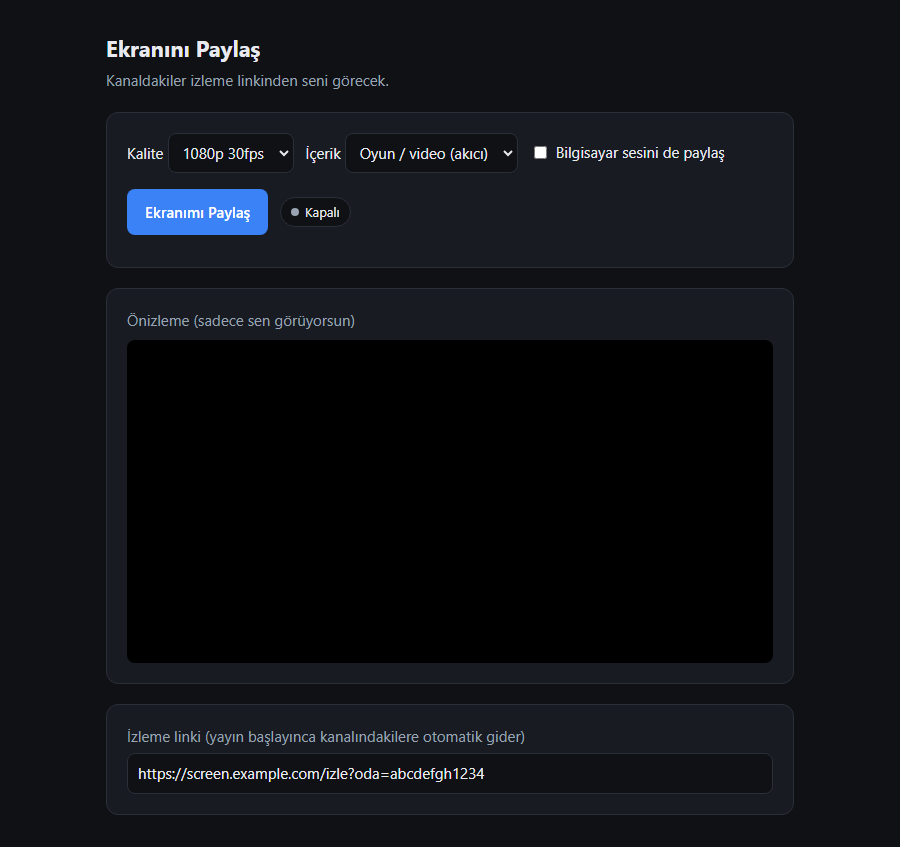
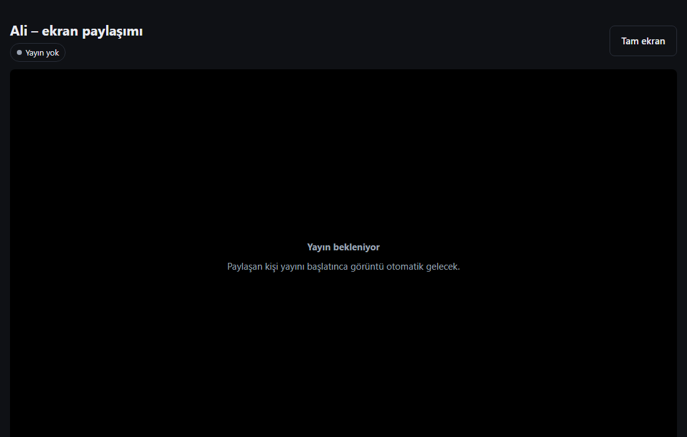

<p align="center"></p>

<h1 align="center">TS3 Screen Share</h1>

<p align="center">
TeamSpeak 3'e <b>eklenti kurmadan</b> ekran paylaşımı: sohbete <code>!ekran</code> yaz, tarayıcıda paylaş, kanaldakiler izlesin.
</p>

<p align="center">


</p>

> **EN:** Browser-based screen sharing for existing TeamSpeak 3 / TeaSpeak servers. A ServerQuery bot hands out
> per-user links, a WebRTC media server (mediamtx, WHIP/WHEP) relays the video, and viewers are authorized against
> their live TeamSpeak session. No client plugin, no extra app. Python stdlib only.

---

TeamSpeak 3 istemcisi görüntü gösteremez; yeni bir istemci ya da eklenti dağıtmak da kullanıcıları kaçırır. Bu proje
TS'i olduğu gibi bırakır: **ses TS'te devam eder, görüntü tarayıcıdan akar.** Bot sunucuya ServerQuery ile bağlanır,
komutları dinler, linkleri dağıtır ve yayın açan kişinin isminin önüne TS ağacında `[CANLI YAYIN]` rozeti koyar.

<p align="center">


</p>

## Özellikler

- 💬 **Komutla çalışır**: sunucu sohbetine `!ekran` → bot özelden kişiye özel paylaşım linki yollar
- 🖥️ **Tarayıcıdan paylaşım**: ekran / pencere / sekme seçimi, 720p–1080p60, isteğe bağlı sistem sesi, oyun/yazı moduna göre kodlama ipucu
- 🔴 **TS içinde CANLI rozeti**: yayın süresince paylaşanın isminin önünde ikon + `[CANLI YAYIN]` (geçici sunucu grubu, yayın bitince kalkar)
- 📨 **Otomatik davet**: yayın başlayınca kanaldaki herkese, sonradan kanala gelene de, kişisel izleme linki özelden gider
- 🔒 **Linkler kişiye özel**: izleme linki TS kimliğine bağlı; sahibi o an sunucuda olmalı ve linki TS'e bağlı olduğu IP'den açmalı. Başkasına iletilen link çalışmaz
- 👀 **Canlı durum**: paylaşan izleyici sayısını görür; izleyen tarafta otomatik yeniden bağlanma, tam ekran, "yayın bekleniyor / bitti" ekranları
- 🧩 Bot tarafı sadece Python standart kütüphanesi; birden çok sanal sunucuyu tek süreçte yönetir

## Nasıl çalışır

```
                   ┌──────────────────────── sunucu ─────────────────────────┐
  TS3 istemcisi ──▶│ TeamSpeak / TeaSpeak ◀──ServerQuery──▶ screenshare_bot.py│
  "!ekran"         │                                         ▲   │  :8890    │
                   │                          auth + hooks   │   │ /api      │
  Tarayıcı ─HTTPS─▶│ nginx ──/m/ (WHIP/WHEP)──▶ mediamtx ────┘   │           │
  (paylaş/izle)    │       ──/api/ ──────────────────────────────┘           │
       ▲           │                    ▲ WebRTC media (UDP/TCP 8189)        │
       └───────────┼────────────────────┘                                    │
                   └─────────────────────────────────────────────────────────┘
```

1. Kullanıcı `!ekran` yazar. Bot 12 karakterlik rastgele bir oda ve gizli bir yayın token'ı üretir, linki **özel mesajla** gönderir.
2. Paylaşım sayfası `getDisplayMedia` ile ekranı alır ve **WHIP** ile mediamtx'e yollar. mediamtx her isteği botun `/auth` ucuna sorar; token doğru değilse yayın açılamaz.
3. Yayın hazır olunca mediamtx `runOnAvailable` kancasıyla botu çağırır → bot paylaşanı `CANLI YAYIN` grubuna ekler, kanaldakilere kişisel linkleri dağıtır.
4. İzleme sayfası **WHEP** ile bağlanır. Bot izni verirken izleyicinin TS'te online olduğunu ve isteğin TS bağlantısıyla aynı IP'den geldiğini kontrol eder.
5. Yayın bitince rozet kalkar; sayfa "yayın bitti" der ve yeniden başlarsa kendiliğinden bağlanır.

## Komutlar

| Komut | Ne yapar |
|---|---|
| `!ekran` | Sana özel paylaşım linki gönderir |
| `!ekran dur` | Paylaşımını kapatır, rozetini kaldırır |
| `!izle` | Sunucudaki açık yayınların kişisel izleme linklerini gönderir |
| `!ekran yardim` | Kısa yardım |

Komutlar **sunucu sohbetine** yazılır (nedeni aşağıda).

## Güvenlik modeli

| Kim | Ne gerekir |
|---|---|
| Yayın açan | Oda token'ı (sadece kendisine özelden gider, sabit zamanlı karşılaştırma) |
| İzleyen | Kendi izleyici anahtarı + o an TS sunucusunda online olmak + TS bağlantısıyla aynı genel IP |
| mediamtx API | Sadece `127.0.0.1` |

- mediamtx'te anonim okuma/yazma kapalı; tüm kararlar `authMethod: http` ile bota sorulur.
- Oda adları `^[a-z0-9]{12}$` dışında hiçbir yola izin verilmez.
- IP kontrolü `ip_check: false` ile kapatılabilir (ör. telefon mobil veride izlenecekse).

## Kurulum

Gereksinimler: Linux sunucu, TeamSpeak 3 veya TeaSpeak (ServerQuery erişimi), Python 3.9+, nginx, bir alan adı ve TLS
sertifikası (tarayıcılar ekran yakalamaya sadece HTTPS'te izin verir), UDP+TCP **8189** portu açık.

```bash
sudo useradd -r -s /usr/sbin/nologin -d /opt/screenshare screenshare
sudo mkdir -p /opt/screenshare && cd /opt/screenshare

# 1) mediamtx
curl -L -o mtx.tgz https://github.com/bluenviron/mediamtx/releases/download/v1.21.4/mediamtx_v1.21.4_linux_amd64.tar.gz
tar xzf mtx.tgz mediamtx
cp <repo>/deploy/mediamtx.yml .          # webrtcAdditionalHosts -> sunucunun genel IP'si

# 2) bot + web
cp <repo>/bot/screenshare_bot.py <repo>/bot/live.png .
cp <repo>/bot/config.example.json config.json   # query_pass, sids, site
cp -r <repo>/web ./web
sudo chown -R screenshare:screenshare /opt/screenshare

# 3) servisler
sudo cp <repo>/deploy/*.service /etc/systemd/system/
sudo systemctl daemon-reload
sudo systemctl enable --now screenshare-mediamtx screenshare-bot

# 4) nginx (alan adını ve sertifika yollarını düzenle)
sudo cp <repo>/deploy/nginx.conf /etc/nginx/sites-available/screenshare.conf
sudo ln -s /etc/nginx/sites-available/screenshare.conf /etc/nginx/sites-enabled/
sudo nginx -t && sudo systemctl reload nginx
```

Önemli ayarlar (`config.json`):

| Anahtar | Açıklama |
|---|---|
| `sids` | Botun çalışacağı sanal sunucular, ör. `[1, 3]` ya da `"all"` |
| `site` | Web sayfalarının adresi, ör. `https://screen.example.com` |
| `live_name_in_tree` | `0` sadece ikon, `1` isim önünde `[CANLI YAYIN]`, `2` isim arkasında |
| `ip_check` | İzleme linkini TS IP'sine bağla (`true`) |
| `room_ttl_hours` | Kullanılmayan oda kaç saat sonra silinsin |

## Yolda öğrendiklerim

- **TeaSpeak 1.4'te query istemcisi kanala giremiyor.** `clientmove` `error id=0 msg=ok` döndürüyor ama `whoami`
  hâlâ `client_channel_id=0` gösteriyor; kanal mesajı `invalid channelID` hatası veriyor. Bu yüzden bot kanal
  sohbetini kullanamıyor: komutlar sunucu sohbetinden alınıyor, duyurular kanal üyelerine tek tek özel mesajla gidiyor.
- **Query yanıtları ile bildirimler aynı sokette karışıyor.** Bir okuyucu thread'i `notify*` satırlarını ayırıp ayrı
  thread'lerde işliyor, komut yanıtları kuyruğa gidiyor; her komut `error id=` satırına kadar bekliyor.
- **İkon yükleme** ServerQuery dosya transferiyle (`ftinitupload` + ham TCP) yapılıyor; ikon kimliği dosyanın
  CRC32'si ve izin değerine **işaretli int32** olarak yazılıyor.
- **Gerçek istemci IP'si**: nginx `X-Forwarded-For` ekliyor, mediamtx'te `webrtcTrustedProxies` ayarı olmazsa yetki
  ucuna 127.0.0.1 gelir ve IP kontrolü anlamsızlaşır.
- **Yalnızca kullandığın kadar aç**: mediamtx varsayılan olarak RTSP/RTMP/HLS/SRT/MoQ dinliyor; hepsi kapatıldı,
  WebRTC HTTP ucu sadece localhost'ta.

## Test

```bash
python -m unittest discover -s tests -v     # 21 birim testi: escape/parse, oda durumu, yetki kararları
python tools/e2e_test.py https://screen.example.com <oda> <token> <anahtar>   # Playwright ile uçtan uca
```

Uçtan uca test bir sekmede ekranı paylaşır, diğerinde izler; görüntünün geldiğini, izleyici sayısını ve yayın
bitişini doğrular.

## İlgili proje

- [ts3-bot-dj](https://github.com/kurlermert/ts3-bot-dj): tarayıcıda çalan şarkıyı tek tıkla TS3 müzik botuna gönderen eklenti.

## Lisans

MIT
